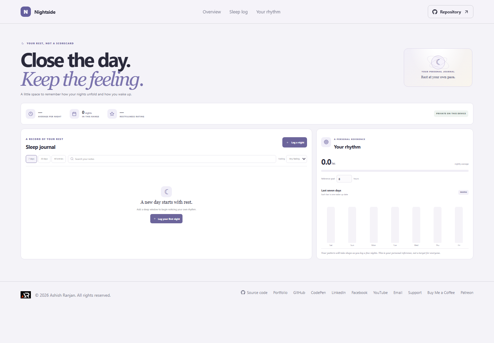

# Nightside: Sleep Journal

Nightside is a quiet place to record when you went to bed, when you woke, and how rested you felt. A simple weekly view helps you notice your own pattern over time.

**Project repository:** https://github.com/a2rp/sleep-journal
**Deployed site:** https://a2rp.github.io/sleep-journal/

## What you can do

- Record a sleep window, wake-up date, and a restfulness rating.
- Add an optional note to remember how the night felt.
- Review sleep duration across the last 7 days, 30 days, or all entries.
- Compare nightly totals in a weekly chart against a personal duration target.
- Search the journal by notes and filter by restfulness.
- Remove a journal entry with a confirmation dialog.

## How to use it

Choose **Log a night**, enter the bedtime and wake-up time, and choose a restfulness rating. The app calculates the elapsed sleep window and adds it to your log. Use the range and rating filters to review a pattern, and adjust the reference target to a value that suits you.

## Data and privacy

Sleep notes, ratings, and the reference target are stored in local storage in this browser. They are not sent to a server. Clearing this browser's site data removes saved entries. Nightside is a personal journal and does not diagnose or provide medical sleep guidance.

## Run and check locally

Install dependencies with `npm install`, then start the Vite development server with `npm run dev`. Run `npm run lint` for ESLint and `npm run build` for a production build. Run `npm run deploy` to publish the `dist` folder to the `gh-pages` branch.

## Future improvements

Ideas only. These are not implemented yet:

- Add an optional evening wind-down checklist.
- Add a printable monthly reflection.
- Add tags for naps and overnight shifts.

## Links

- Portfolio: [https://www.ashishranjan.net](https://www.ashishranjan.net)
- GitHub: [https://github.com/a2rp](https://github.com/a2rp)
- CodePen: [https://codepen.io/ash1198](https://codepen.io/ash1198)
- LinkedIn: [https://www.linkedin.com/in/aashishranjan](https://www.linkedin.com/in/aashishranjan)
- Facebook: [https://www.facebook.com/theash.ashish/](https://www.facebook.com/theash.ashish/)
- YouTube: [https://www.youtube.com/@ashishranjan-ashz?sub_confirmation=1](https://www.youtube.com/@ashishranjan-ashz?sub_confirmation=1)
- Email: [mailto:ash.ranjan09@gmail.com](mailto:ash.ranjan09@gmail.com)

## Support

- Support: [https://a2rp-donation-page.netlify.app/](https://a2rp-donation-page.netlify.app/)
- Buy Me a Coffee: [https://buymeacoffee.com/ashishranjan](https://buymeacoffee.com/ashishranjan)
- Patreon: [https://www.patreon.com/ashishranjan](https://www.patreon.com/ashishranjan)